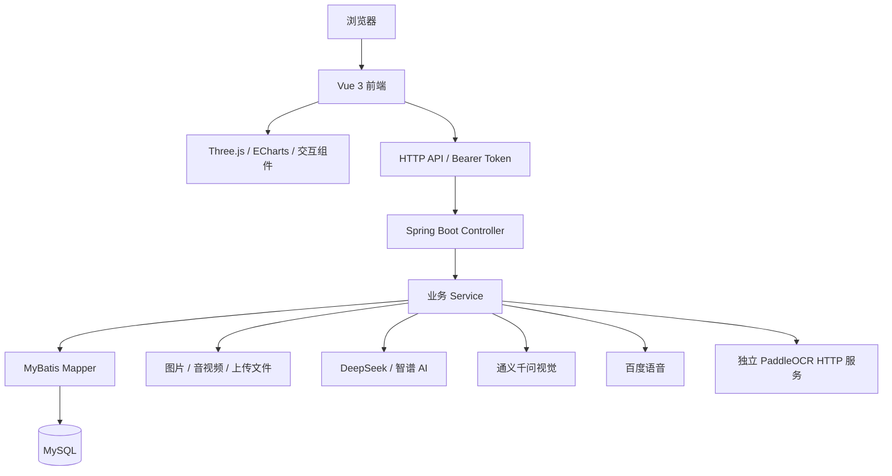

# 技术架构与核心流程

本文以公开仓库中的代码为依据。答辩材料中提到但尚未公开的实现单独记录在[公开范围说明](project-status.md)。

## 系统分层

## 前端

前端采用 Vue 3 组合式 API，以 Vue Router 组织页面，Pinia 管理状态。主要业务页面位于 `src/pages/`，朗诵练习的部分页面位于 `src/recite/`，公共组件位于 `src/components/`。

| 位置（相对于前端工程） | 职责 |
| --- | --- |
| `src/router/index.js` | 页面路由与导航 |
| `src/utils/api.js` | HTTP 请求封装、Bearer 请求头、业务 API 调用 |
| `src/pages/home/` | 首页专题与交互展示 |
| `src/pages/splat/` | 三维诗境列表与详情 |
| `src/pages/PoetryMap.vue` | 诗人足迹地图 |
| `src/pages/chuangzuo/` | 作品发布、详情、搜索与消息 |
| `src/pages/game/` | 诗词互动游戏 |
| `src/pages/center/` | 个人资料、收藏、社交关系与统计 |
| `public/viewers/` | 三维场景 HTML 查看器 |
| `vite.config.js` | 开发服务、别名与代理配置 |

## 后端

Java 代码位于后端工程的 `src/main/java/com/shici/`，按 Controller、Service、Mapper 与领域对象组织。SQL 同时存在于 Mapper 注解与 `resources/mapper/` 的 XML 文件中。

| 目录 / 组件 | 职责 |
| --- | --- |
| `controller/` | 接收 HTTP 请求与参数，返回业务结果 |
| `service/` | 诗词、创作、朗诵、社区、AI 等业务逻辑 |
| `mapper/` | MyBatis 数据访问接口 |
| `domain/` | 领域对象与请求 / 响应对象 |
| `config/` | 外部服务、静态资源、跨域与 Token 处理 |
| `resources/mapper/` | MyBatis XML SQL |
| Springdoc | 根据接口生成 OpenAPI 文档 |

## 核心流程

### 诗词浏览与检索

前端收集搜索词与筛选条件，调用诗词接口。后端通过 Service 与 MyBatis 查询 MySQL，返回分页数据或详情，前端渲染诗词内容、分类与相关资源。

典故推荐由 `StoryRecommendServiceImpl` 组合内容推荐、Item-CF 协同过滤与热门兜底，并处理缺少行为数据时的冷启动情况。这一实现属于典故推荐，不能直接等同于联邦学习或图神经网络模型。

### AI 学习与创作

诗词问答、虚拟诗人和作品润色通过后端调用外部模型 API，密钥保留在服务端。`AIConfig` 封装 DeepSeek 请求，`ChatAssistantService` 对接智谱 AI 并携带会话历史。

创作页包含约 800 毫秒防抖逻辑，减少输入过程中频繁触发分析请求。该值是触发等待时间，不代表模型响应耗时。

### 图片识诗与配诗

`PaddleOcrService` 对上传图片做预处理后，以 Base64 JSON 请求独立 OCR 服务。图片的画面分析由 `QwenVisionService` 对接视觉模型。识别、查询与推荐还需要数据库中的诗词记录支持。

### 朗诵与语音

前端提供录音与播放交互，后端处理上传资源并对接语音服务。媒体目录、百度语音凭据和业务数据是复现此流程的必要依赖。仅配置文字模型不能替代语音服务。

### 认证与交流

前端从本地存储读取 Token，并通过 `Authorization: Bearer ...` 发送。`TokenInterceptor` 提取 Token 后，调用 `TokenService` 查询用户身份。`LoginAttemptService` 在单机内存中维护失败次数，达到 8 次后锁定约 10 分钟。

当前公开社区代码通过 HTTP 接口处理消息，`ForumChat.vue` 包含定时轮询。尚未找到 WebSocket/STOMP 的服务端配置与对应依赖，因此本图按实际 HTTP 实现描述。

## 数据与资源

数据库结构、诗词正文、典故、用户行为记录及媒体引用共同构成业务数据。三维查看器与部分图片存在于前端目录，用户上传文件与部分业务资源则依赖外部文件目录。

`database/shici-full.sql` 提供作者导出的数据库快照，包含 81 张表的结构与现有演示数据。按[数据库导入说明](../database/README.md)初始化后，再配置业务所需的媒体文件与外部服务；数据库导出不包含磁盘上的图片、音视频或模型文件。
