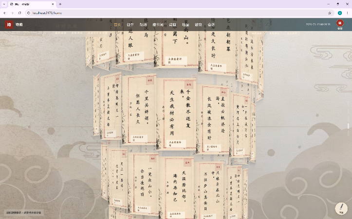
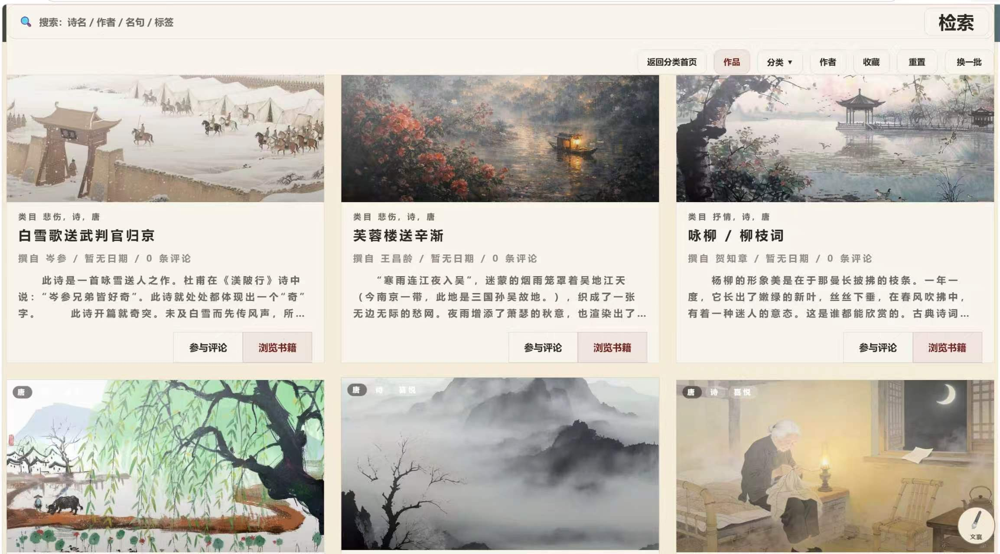
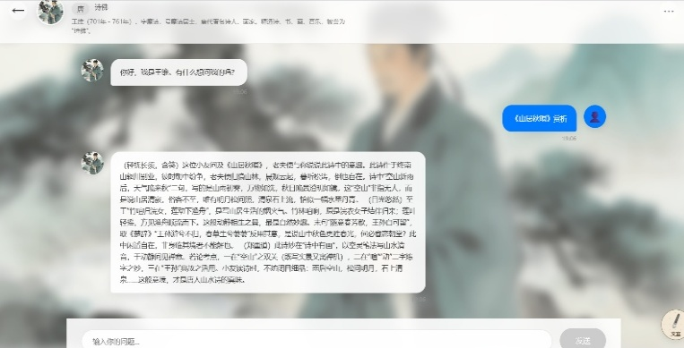
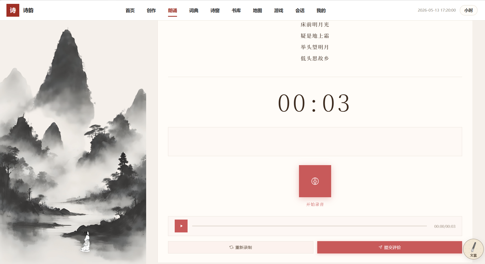
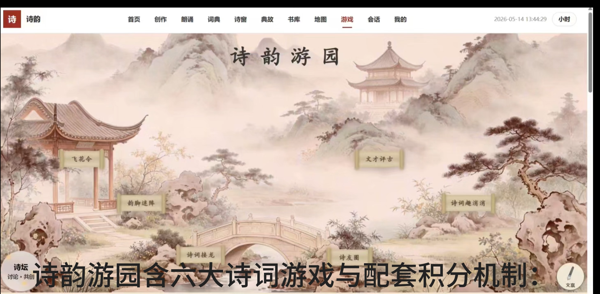
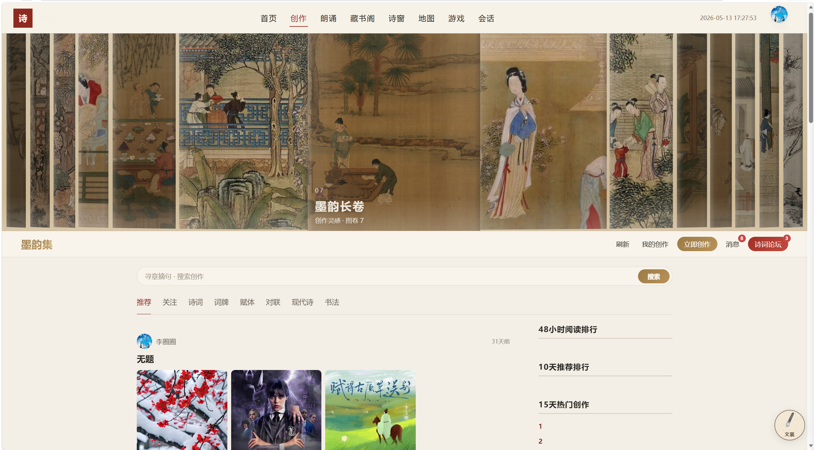
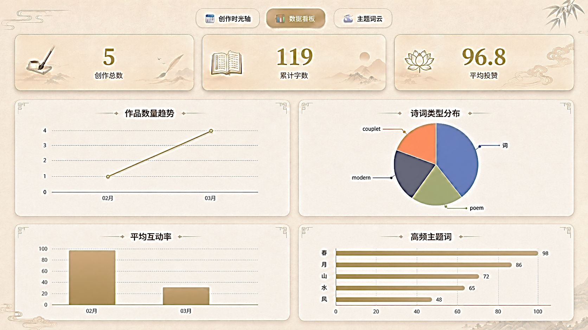

# 界面展示

以下图片从作者提供的项目答辩 PPT 原图中提取，展示答辩版本界面；本页截图并非本次重新启动网站后的截图。展示数据不代表当前用户量或实际运营指标。

## 诗词交互展厅

以古籍、书画与诗词卡片组织交互展示。来源：答辩 PPT 第 10 页。

## 藏书阁

提供诗词资源浏览与阅读入口。来源：答辩 PPT 第 15 页。

## AI 虚拟诗人

通过角色对话辅助诗词阅读与理解。来源：答辩 PPT 第 13 页。

## 朗诵练习

提供录音、时长显示和提交练习的交互。来源：答辩 PPT 第 16 页。

## 互动游戏

通过诗词游园组织趣味练习入口。来源：答辩 PPT 第 19 页。

## 创作社区

将作品展示、创作入口与排行组织在同一页面。来源：答辩 PPT 第 20 页。

## 个人数据看板

展示个人创作与学习相关统计。来源：答辩 PPT 第 22 页。

[返回项目首页](../README.md)
